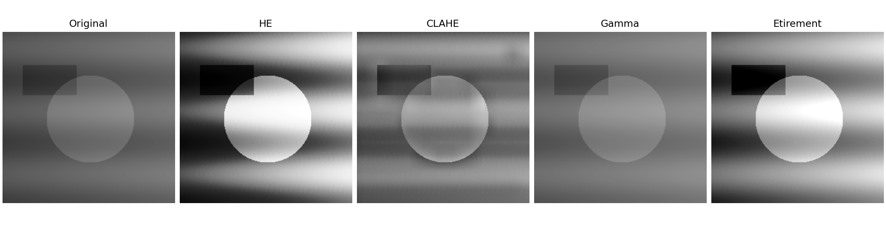
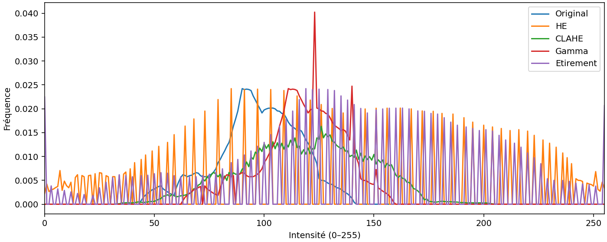

# Image Contrast Lab

Application académique Python / Streamlit pour comparer des méthodes d’amélioration du contraste en niveaux de gris. Évolution du mini-projet initial consacré à HE et CLAHE : métriques corrigées, deux méthodes supplémentaires et export reproductible des résultats.

<!-- application-screenshots:start -->
## Captures de l’application


<!-- application-screenshots:end -->

## Aperçu des résultats

Exemple synthétique généré par le projet, sans données de patient. Ces figures sont des sorties de calcul, pas des captures de l’interface.





## Fonctionnalités

- Import PNG/JPEG 8 bits, conversion en niveaux de gris ; démonstration disponible sans fichier.
- Comparaison de l’original, HE, CLAHE, gamma et étirement entre les percentiles 2 et 98.
- CLAHE manuel ou heuristique selon l’écart-type ; aucun modèle entraîné.
- MSE, PSNR, SSIM, écart-type et entropie pour toutes les méthodes.
- Téléchargement d’une image PNG ou d’un ZIP avec les cinq images, deux graphiques, les métriques CSV et les paramètres JSON.

## Installation et lancement

Python 3.12 recommandé. Depuis le dossier du projet, dans PowerShell :

```powershell
python -m venv .venv
.\.venv\Scripts\python.exe -m pip install -r requirements.txt
.\.venv\Scripts\python.exe -m streamlit run Application.py
```

Ouvrir l’adresse locale indiquée dans le terminal, généralement http://localhost:8501. Aucune base de données ni connexion administrateur n’est nécessaire.

## Interprétation des mesures

L’image originale sert de référence : une forte similarité ne démontre pas une amélioration de qualité. PSNR est infini lorsque deux images sont identiques. Les différences sont calculées en virgule flottante pour éviter les débordements des pixels `uint8`. SSIM utilise une plage de 255 et une fenêtre adaptée aux petites images.

Gamma suit `sortie = 255 × (entrée / 255)^gamma` : gamma inférieur à 1 éclaircit. L’étirement peut saturer les extrémités de l’histogramme. CLAHE peut aussi amplifier du bruit. L’heuristique utilise les seuils d’écart-type 30 et 50 du projet initial ; ce n’est pas une optimisation apprise.

Projet pédagogique, sans validation clinique. Les formats DICOM et les images 16 bits ne sont pas pris en charge. Les entrées sont limitées à 20 Mo, 12 millions de pixels et au moins 3 × 3 pixels. Les images importées et les exports restent en mémoire jusqu’au téléchargement ; aucune sauvegarde automatique sur disque n’est effectuée.

## Organisation

```text
Application.py        Interface Streamlit
src/processing.py     Traitements, métriques et exports
tests/                Vérifications des calculs et des exports
screenshots/          Figures synthétiques visibles sur GitHub
requirements.txt      Dépendances
VALIDATION.md         Vérifications et limites
```

Les documents et images du dossier original sont conservés séparément dans `archives-originales/`, hors du dossier à publier. Leur contenu et leurs droits de diffusion n’ont pas été vérifiés. Aucune licence n’a été ajoutée automatiquement.

## Tests

```powershell
.\.venv\Scripts\python.exe -m unittest discover -s tests -v
```

## Références techniques

- [SSIM et métriques scikit-image](https://scikit-image.org/docs/stable/api/skimage.metrics.html)
- [Tests d’interface Streamlit](https://docs.streamlit.io/develop/concepts/app-testing/get-started)
